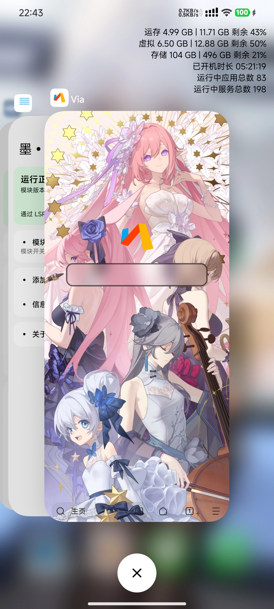

### MIUI桌面增强模块

墨桌的api101版本，ui换成miuix，使用了热刷新

应该适配miui12~os4，如果是rust桌面则不适配

如果miui11能用直接提pr或者issue

## 效果展示

<div align="center">
  

## 构建

```bash
git clone https://github.com/NotWayOut/Fuck_Home.git
cd Fuck_Home
.\gradlew :app:assembleRelease -PversionCode=9999 -PversionName="9.9.9"
```

签名配置读取 `local.properties`（`STORE_FILE` / `STORE_PASSWORD` / `KEY_ALIAS` / `KEY_PWD`）或同名环境变量，缺失时 release 退化为 debug 签名。

## 致谢

本项目的发展离不开以下开源项目与作者：

### 作者

- [xiaowine](https://github.com/xiaowine) — 原作者
- [NotWayOut](https://github.com/NotWayOut) — libXposed API 101 重构
- 大肥鱼

### 引用与致谢

- [Xposed](https://github.com/rovo89/Xposed) — Xposed 框架
- [LSPosed](https://github.com/LSPosed/LSPosed) — 现代 Xposed 框架实现
- [libXposed API](https://github.com/libxposed) — API 101 模块开发接口
- [blockmiui](https://github.com/Block-Network/blockmiui)
- [EzXHelper](https://github.com/KyuubiRan/EzXHelper)
- [miuix](https://github.com/compose-miuix-ui/miuix) — Compose Multiplatform UI 库
- [XiaomiHelper](https://github.com/HowieHChen/XiaomiHelper)
- [KtSh](https://github.com/jaredrummler/KtSh) — Shell 执行库
- 群友 — 20块钱的大肥鱼跟免费鸡蛋

## 许可

本项目基于 [Apache License 2.0](./LICENSE) 开源。

使用前请阅读并同意 [最终用户许可协议与隐私条款](./EULA.md)：本模块仅供个人学习交流使用，不得用于商业用途或牟利，请自行承担一切使用风险。

## 免责声明

本模块通过 Hook 系统桌面实现功能，仅供测试与娱乐使用。因使用本模块造成的任何意外与风险由使用者本人承担，作者不承担任何责任。
